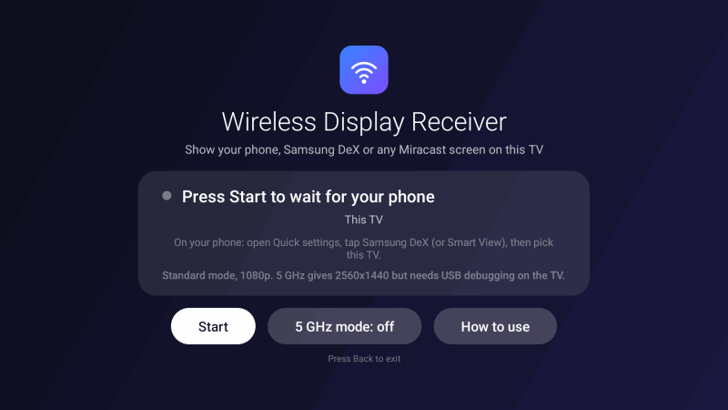
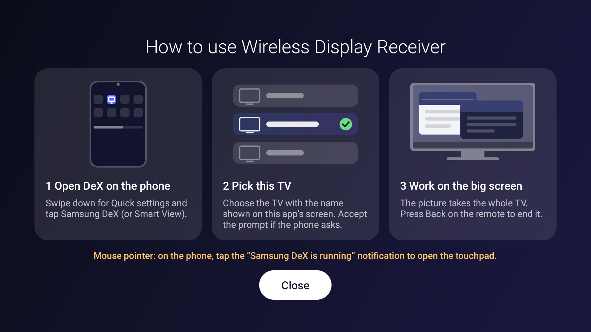
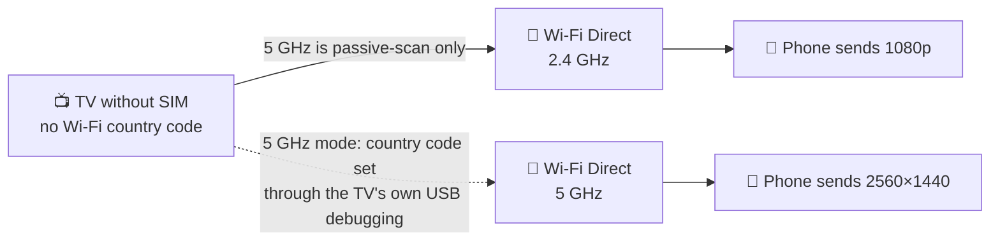
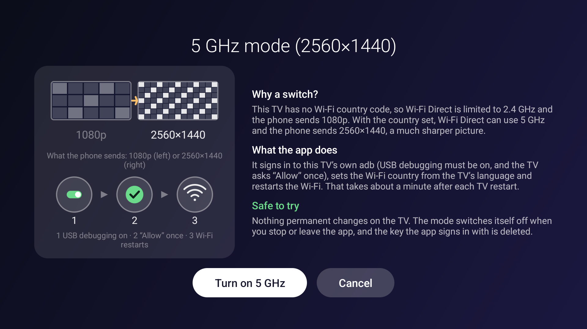

<div align="center">


# Wireless Display Receiver

**A Miracast (Wi-Fi Display) receiver for Google TV and Android TV,<br>made for Samsung DeX wireless and plain phone screen mirroring.**


[Install](#-install) &nbsp;·&nbsp; [Using it](#-using-it) &nbsp;·&nbsp; [5 GHz mode](#-5-ghz-mode) &nbsp;·&nbsp; [How it works](docs/how-it-works.md) &nbsp;·&nbsp; [Security](docs/how-it-works.md#security) &nbsp;·&nbsp; [Tests](#-tests)

<br>



</div>

> [!NOTE]
> Independent project. It is not made by, or affiliated with, Samsung, Google, Sony or the Wi-Fi Alliance.
> "Samsung", "DeX", "Miracast", "Google TV" and "Sony" are the names of their owners and are used only to
> say what the app works with.

---

## ✨ What it does

<table>
<tr>
<td width="33%" valign="top">

### 📺 A receiver the TV lacks
Android has no Miracast receiver app, and the one in some TV firmware never starts a session.

- 📡 Wi-Fi Direct, **no router or cable**
- 🔊 Picture **and sound**
- 🪶 One small app, no ads, no tracking

</td>
<td width="33%" valign="top">

### 🔍 Sharp and smooth
Tuned for a desktop-like picture.

- 🖥️ **HEVC 2560×1440** for Samsung phones
- 🎞️ Never drops a picture; frames shown with adaptive timing
- ⚡ Hardware decoder, low-latency Wi-Fi lock

</td>
<td width="33%" valign="top">

### 🔐 You stay in control
Nothing starts or changes by itself.

- ▶️ Searches only after you press **Start**
- 🛡️ **5 GHz mode** is optional and switches itself off when you leave
- 📖 In-app illustrated instructions

</td>
</tr>
</table>

## 📦 Install

You need an **Android 11+ TV** (built and tested on a Sony BRAVIA with Google TV, Android 12) and a
**Samsung phone with DeX or Smart View**.

> [!NOTE]
> The author tested only a Sony BRAVIA (Google TV) with a Samsung Galaxy phone. A contributor reported that a
> **Windows 11** laptop also shows on a **Fire TV Stick** (LineageOS 20, MediaTek MT8695); the author has not
> tested that. On that setup the Android TV system still needed two things outside the app (it does not
> advertise itself as a display sink, and its connection dialog takes the focus).

```powershell
.\build.ps1                       # -> build\displayreceiver.apk
adb install -r build\displayreceiver.apk
```

`build.ps1` needs JDK 17 and the Android SDK (platform 34, build-tools 34.0.0); it makes its own signing
key the first time. If the TV shows no permission dialog, grant the location permission (Wi-Fi Direct
events are only delivered to apps that hold it):

```powershell
adb shell pm grant lt.tvcast.displayreceiver android.permission.ACCESS_FINE_LOCATION
```

## ▶️ Using it

1. Open **Wireless Display Receiver** on the TV and press **Start**. It says *Ready, waiting for your phone* and shows
   the name the phone will see.
2. On the phone: swipe down for Quick settings, tap **Samsung DeX** (or **Smart View**), pick the TV.
3. The picture and sound start in a second or two and fill the screen. **Back** on the remote ends it.

The **How to use** button shows the same steps with pictures:

<div align="center">

</div>

> [!TIP]
> For a mouse pointer, tap the *Samsung DeX is running* notification on the phone to open the touchpad.

## 📶 5 GHz mode



A TV has no SIM to take a Wi-Fi country code from, so 5 GHz channels are listen-only and the Wi-Fi Direct
group starts on 2.4 GHz; the phone then settles for 1080p. 5 GHz mode sets the country code, and the
picture becomes much sharper. It is **off by default** and explained in the app before it changes anything:

<div align="center">

</div>

> [!WARNING]
> Turning it on needs **USB debugging** on the TV and gives the app a shell on that TV for the visit.
> The mode switches itself off when you press Stop or leave the app, and the key the app signs in with is
> deleted each time. A country code selects the legal radio rules: **use only the country you are in**,
> and switch USB debugging off when you are done. Nothing permanent is changed; the code is held in memory
> until the TV restarts.

<details>
<summary><b>Prefer not to use the app for this?</b></summary>

`enable-5ghz.ps1` does the same from a PC over adb:

```powershell
.\enable-5ghz.ps1 -Ip <TV IP>          # or write the address into tv-ip.txt
.\enable-5ghz.ps1 -Country DE          # another country
```

</details>

## 🧪 Tests

```powershell
.\tests\run-tests.ps1             # 35 Java tests (no Android needed) + a parse check of the scripts
```

The plain-Java parts (ADB wire format, RTSP reading, the capabilities the app announces, the country-code
check) are compiled without `android.jar`, which also proves they need no Android.

## 📚 Documentation

| | | |
|---|---|---|
| 📖 | [docs/how-it-works.md](docs/how-it-works.md) | Why a receiver app is needed, the Miracast conversation, looking like a Samsung TV, 5 GHz and 2560×1440, what limits the picture, security, what was tried, what is not done |

<details>
<summary><b>🧱 Project layout</b></summary>

```
src/lt/tvcast/displayreceiver/   MainActivity, RtspSink, TsPlayer, SelfAdb, Guide, PictureView
                             + plain-Java AdbWire, RtspText, WfdCaps, CountryCode
res/                         UI strings (English, Lithuanian) and vector icons
tests/                       unit tests and the runner
build.ps1                    builds and signs the APK with the SDK build-tools only (no Gradle)
enable-5ghz.ps1              the same 5 GHz setup from a PC
```

</details>

## ⚖️ Trademarks, privacy and responsibility

- **Trademarks.** Miracast is a trademark of the Wi-Fi Alliance. Samsung and DeX are trademarks of Samsung
  Electronics. Google TV is a trademark of Google, and Sony is a trademark of Sony Group. They are used here
  only to say what the app works with; this project is not certified, endorsed or affiliated.
- **Privacy.** The app sends no data anywhere: it has no analytics, no accounts and makes no internet
  requests. All of its traffic stays between the phone and the TV over Wi-Fi Direct, plus, if you turn on
  5 GHz mode, a connection from the app to the TV's own adb on the same device. The log holds only
  technical messages.
- **Country code.** 5 GHz mode takes the Wi-Fi country from the TV's *language*, which is not always the
  country you are in. Check that it matches where you are, or leave the mode off.
- **No warranty.** The app is provided as is, under the [MIT licence](LICENSE). You use it, and the 5 GHz
  mode in particular, at your own risk.

## 📄 Licence

MIT, see [LICENSE](LICENSE).
